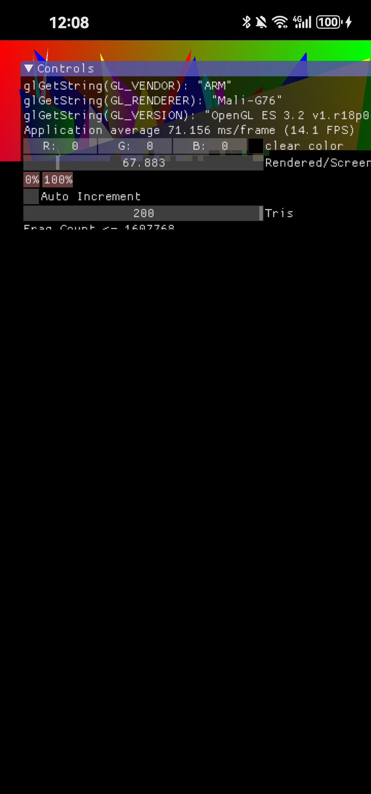
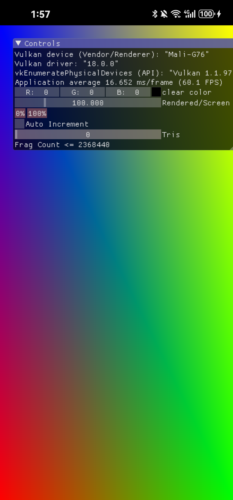

# TriangleBin-MultiPlatform

[English](README_EN.md) | 中文

[TriangleBin](https://github.com/Swung0x48/TriangleBin) 的多平台移植合集，用于测试 GPU 的填充率与着色顺序：

- **Windows DirectX** — Direct3D 11 / 12，x86 / x64 / ARM64，支持 Windows 7 及更新系统
- **Windows Vulkan** — Vulkan 1.0，x86 / x64 / ARM64，支持 Windows 7 及更新系统（需显卡驱动提供 Vulkan 支持）
- **macOS Metal** — Intel（macOS 10.13+）与 Apple Silicon（macOS 11.0+）通用版
- **Android OpenGL ES** — OpenGL ES 3.2（不支持时自动回退 3.1），单 APK 含四套 ABI，支持 Android 5.0 及更新系统
- **Android Vulkan** — Vulkan 1.0，单 APK 含四套 ABI，支持 Android 7.0 及更新系统
- **HarmonyOS 源码包（自行签名）** — 一套源码覆盖手机、平板、2in1、手表、车机、电视六类设备；Vulkan 1.0；内置 XEngine 1.5× 空间超分

HarmonyOS 版用同一套源码适配六类设备：手机 / 平板 / 2in1 共用桌面布局，手表支持表冠与触屏两种输入，车机 / 电视使用宽屏 Controls。

它绘制一叠互相重叠的三角形，并统计 GPU 实际光栅化了多少个片段。这个数量可以判断你的显卡是 **IMR**（立即模式渲染，每个三角形的每个覆盖像素都要着色）还是 **TBR**（分块渲染，几何按 tile 分桶，每个像素基本只着色一次）。

## 下载

最新版本：[**v1.1.0**](https://github.com/ddYIbb/TriangleBin-MultiPlatform/releases/tag/v1.1.0)

| 平台 | Release 文件 | 架构 |
|---|---|---|
| Windows DirectX | [TriangleBin-Windows-DirectX-v1.1.0.exe](https://github.com/ddYIbb/TriangleBin-MultiPlatform/releases/download/v1.1.0/TriangleBin-Windows-DirectX-v1.1.0.exe) | x86 / x64 / ARM64 |
| Windows Vulkan | [TriangleBin-Windows-Vulkan-v1.1.0.exe](https://github.com/ddYIbb/TriangleBin-MultiPlatform/releases/download/v1.1.0/TriangleBin-Windows-Vulkan-v1.1.0.exe) | x86 / x64 / ARM64 |
| macOS Metal | [TriangleBin-macOS-Metal-v1.1.0.zip](https://github.com/ddYIbb/TriangleBin-MultiPlatform/releases/download/v1.1.0/TriangleBin-macOS-Metal-v1.1.0.zip) | Universal（Intel / Apple Silicon） |
| Android OpenGL ES | [TriangleBin-Android-OpenGLES-v1.1.0.apk](https://github.com/ddYIbb/TriangleBin-MultiPlatform/releases/download/v1.1.0/TriangleBin-Android-OpenGLES-v1.1.0.apk) | arm64-v8a / armeabi-v7a / x86 / x86_64 |
| Android Vulkan | [TriangleBin-Android-Vulkan-v1.1.0.apk](https://github.com/ddYIbb/TriangleBin-MultiPlatform/releases/download/v1.1.0/TriangleBin-Android-Vulkan-v1.1.0.apk) | arm64-v8a / armeabi-v7a / x86 / x86_64 |
| HarmonyOS 源码包（自行签名） | [TriangleBin-HarmonyOS-Source-20261120.zip](https://github.com/ddYIbb/TriangleBin-MultiPlatform/releases/download/v1.1.0/TriangleBin-HarmonyOS-Source-20261120.zip) | DevEco Studio 工程（不含签名） |

> HarmonyOS 源码包的 <code>module.json</code> 声明 <code>phone</code>、<code>tablet</code>、<code>2in1</code>、<code>wearable</code>、<code>car</code>、<code>tv</code> 六类设备；构建产物为单个 HAP，同时含 <code>arm64-v8a</code> 与 <code>x86_64</code>。

> HarmonyOS 不提供预编译 HAP：开发调试签名会绑定已登记设备，不适合公开下载。请下载源码包，用 DevEco Studio 的“自动签名”为自己的设备签名后构建；面向所有用户公开发布时，请使用 AppGallery Connect 的 release 证书/Profile。

> **不确定下载哪个？** Windows 用户直接选 **DirectX 版**即可：兼容性最好，会在 D3D12 与 D3D11 之间自动选择。需要做 Vulkan 对比测试时再使用 **Vulkan 版**。下载文件的 SHA-256 校验值见 [Release 说明](https://github.com/ddYIbb/TriangleBin-MultiPlatform/releases/tag/v1.1.0)。

Windows 两个版本都是**单文件启动器**：一个 <code>.exe</code> 内含 x86 / x64 / ARM64 三份程序，启动时自动识别 CPU 并运行对应版本，退出后自动清理；无需安装，不写注册表。

macOS Metal 版解压后得到 <code>TriangleBin.app</code>，为 Intel 与 Apple Silicon 通用二进制。若首次打开被 Gatekeeper 拦截，请右键选择“打开”。

HarmonyOS 源码包构建出的 HAP 内同时含 arm64-v8a 与 x86_64；手表每次进入前台会先选择“有表冠 / 无表冠（触屏）”，车机与电视自动使用宽屏 Controls 布局。

## 平台与系统要求

| 版本 | 操作系统 | 图形 API | 备注 |
|---|---|---|---|
| Windows DirectX | Windows 7 及更新 | Direct3D 12 / 11（自动选择） | 着色器已内嵌，无需 <code>d3dcompiler_47.dll</code> 或 VC++ 运行库 |
| Windows Vulkan | Windows 7 及更新 | Vulkan 1.0 core + <code>VK_KHR_swapchain</code> | 需要显卡驱动提供 Vulkan loader |
| macOS Metal | macOS 10.13+（Intel）/ 11.0+（Apple Silicon） | Metal | 通用二进制 |
| Android OpenGL ES | Android 5.0+（API 21） | OpenGL ES 3.2 / 3.1（自动回退） | 单 APK 含 arm64-v8a / armeabi-v7a / x86 / x86_64；需要设备支持 ES 3.1 |
| Android Vulkan | Android 7.0+（API 24） | Vulkan 1.0+ | 单 APK 含 arm64-v8a / armeabi-v7a / x86 / x86_64 |
| HarmonyOS 源码包 | HarmonyOS 5.0+（API 12） | Vulkan 1.0 | 构建产物为单 HAP，声明 phone / tablet / 2in1 / wearable / car / tv 六类设备；手表支持表冠与触屏两种输入 |

## 功能亮点

**自动选择图形 API。** Windows DirectX 版会优先创建 Direct3D 12 设备，失败则回退到 Direct3D 11 并在日志中说明。

**一套源码，六类设备。** HarmonyOS 版用同一套源码声明 <code>phone</code>、<code>tablet</code>、<code>2in1</code>、<code>wearable</code>、<code>car</code>、<code>tv</code> 六类设备，构建产物是单个 HAP：手机 / 平板 / 2in1 使用桌面布局，车机 / 电视按屏幕尺寸切换到宽屏，手表使用圆形安全区面板。手表每次进入前台会先选择“有表冠”或“无表冠（触屏）”，分别走表冠旋转或 -/+ 按钮，两种模式都保留 ppf、Tris、Reset 与 Auto Increment。

**XEngine 1.5× 空间超分。** HarmonyOS Vulkan 版加入 XEngine 空间超分：场景按每轴 2/3 的长度渲染，再由 <code>XEG_spatial_upscale</code> 扩展到原生分辨率，等效 1.5× 超分。设备支持时默认开启，Controls 内可随时切换；不支持时自动显示 <code>unsupported</code> 并保持关闭，不影响普通渲染路径。

**选择 GPU（F2）。** Windows DirectX 与 Windows Vulkan 版均可在运行时选择显卡：DirectX 版列出所有硬件 DXGI 适配器及驱动版本，不支持 D3D12 的会标注 <code>(D3D11 only)</code>；Vulkan 版列出 Vulkan 物理设备及驱动/Vulkan 版本。这在同时有核显和独显的笔记本上很有用——Windows 默认分配的那块不一定是你想测的那块。<code>Auto (best GPU for this app)</code> 保持默认行为。切换适配器需要重建设备，界面会对连续点击做 300 ms 防抖，合并成一次切换，并等待上一帧完成后才释放旧设备，避免偶发卡死。同一块物理显卡被驱动或虚拟显示适配器重复枚举时，选择列表会按 PCI 身份（VendorId / DeviceId / SubSysId / Revision）和驱动版本自动合并，只保留一项。

**启动诊断报告。** 启动遇到致命错误（例如找不到支持 DirectX 11 的设备）或发生未处理异常时，程序会在可执行文件旁边生成 <code>trianglebin-error-report.txt</code>，内含系统版本与内部版本号、CPU 架构、显卡名称、驱动版本、支持的最高 DirectX 特性级别，以及具体错误。排查启动闪退时把这个文件发出来就够了。

**运行时数值标注。** 原版通过 <code>glGetString(...)</code> 显示的几项信息，现在标注了对应的 DirectX 调用来源：<code>DXGI GetDesc</code>（适配器）、<code>DXGI CheckInterfaceSupport</code>（驱动版本）、<code>D3D12CreateDevice</code> / <code>D3D11CreateDevice</code>（所用设备）。Vulkan 版同样显示设备、驱动与 Vulkan 版本。

**ARM64 支持。** x86、x64、ARM64 三个配置共用同一份源码。ARM64 采用静态链接 SDL2（<code>deps/SDL2/lib/arm64/SDL2-static.lib</code>），因为 MSVC 下无法链接 SDL2 的动态库；<code>src/sdl2_atomic_shim.c</code> 负责补齐缺失的 <code>_Interlocked*</code> 符号。

**单文件启动器。** <code>tools/launcher</code> 会把 x64、x86、ARM64 三份程序作为资源嵌入同一个可执行文件，运行时释放与当前 CPU 匹配的那一份。发布时因此只需要一个 <code>.exe</code>，而不用为每个架构单独打包。

**性能与显存。** DirectX 与 Vulkan 后端优先使用 <code>D16_UNORM</code> 深度缓冲（0–200 层三角形仍有足够精度，深度缓冲内存减半）；D3D11 缓存每个后缓冲区的 RTV，并用动态常量缓冲与 GPU 端 UAV 清零更新每帧数据；D3D12 使用 <code>ClearUnorderedAccessViewUint</code> 清零片段计数器，省掉每帧两次资源屏障和一次 4 字节拷贝；D3D11 / D3D12 / Vulkan / Metal 在三角形数量不变时均跳过随机顶点缓冲的重复上传。

## 与原项目的关系

这是一个多平台移植合集，不是打补丁。核心思路、控制项和测量方式来自 Swung 0x48 的 [TriangleBin](https://github.com/Swung0x48/TriangleBin)（MIT）；Windows DirectX 版源码位于本仓库，Windows Vulkan、macOS Metal、Android 两版以 [Releases](https://github.com/ddYIbb/TriangleBin-MultiPlatform/releases) 成品提供；HarmonyOS 源码包也作为 Release 资产提供（Android 源码在独立的 Gradle + NDK 工程中维护；HarmonyOS 源码在独立的 DevEco Studio 工程中维护）。

| | [TriangleBin](https://github.com/Swung0x48/TriangleBin) | TriangleBin-MultiPlatform（本仓库） |
|---|---|---|
| 图形 API | OpenGL / OpenGL ES | Windows DirectX 11/12、Windows Vulkan 1.0、macOS Metal、Android OpenGL ES 3.1、Android Vulkan 1.0、HarmonyOS Vulkan 1.0 |
| 平台 | Android（APK，按 ABI 分包）+ Windows x64 | Windows：x86 / x64 / ARM64；macOS：Intel / Apple Silicon；Android：单 APK 四 ABI；HarmonyOS：源码包构建出的单 HAP 覆盖 phone / tablet / 2in1 / wearable / car / tv |
| 构建 | Gradle + Android NDK | CMake + MSVC（Windows DirectX 源码）；Vulkan / macOS 以 Releases 成品提供；HarmonyOS 以 Releases 源码包提供（DevEco Studio + ArkTS/C++ 工程） |
| 选择 GPU | 无 | Windows DirectX / Vulkan 版支持运行时选择 GPU（F2） |
| 启动失败诊断 | 无 | Windows 启动失败时生成诊断报告；Android 版在图形上下文创建失败时打印原因并优雅退出，不闪退 |
| 空间超分 | 无 | HarmonyOS Vulkan 版支持 XEngine 1.5× 空间超分（<code>XEG_spatial_upscale</code>） |

## Android 版与原版 TriangleBin 的区别

Android 两个版本都是原版 Android 应用的源码级再构建（原版只提供 OpenGL ES 版，且要求 ES 3.2），**界面、控件、着色器、Frag Count 计算方式完全一致**，只做了下面这几处兼容性与性能改动：

| 项目 | 原版 TriangleBin（Android） | 本仓库 Android 版 |
|---|---|---|
| 渲染上下文 | 直接创建 OpenGL ES 3.2 上下文，设备只支持 3.1 时创建失败并崩溃退出 | 先试 ES 3.2，失败后记录 <code>Could not create OpenGL ES 3.2 context, retrying 3.1</code> 并改用 ES 3.1 重建；两者都失败时打印 <code>Could not create required OpenGL ES 3.1 context.</code> 后正常退出，不闪退 |
| 最低图形能力 | OpenGL ES 3.2 | OpenGL ES 3.1（着色器依赖 <code>atomicCounterIncrement</code> 与 std140 UniformBlock，ES 3.0 无法实现，因此 3.1 是硬底线） |
| <code>ppf</code> 显示 | 格式串为 <code>"%.1f%%"</code>，Android bionic 的 <code>vsnprintf</code> 把 <code>%%</code> 压成一个 <code>%</code>，界面数字错位 | 格式串改为 <code>"%.1f"</code>，显示 <code>1.0</code>，与桌面版一致 |
| 应用名 / 包名 | Triangle Bin / <code>com.socpk.trianglebin</code>，GLES 与 Vulkan 版互相顶掉 | Triangle Bin (GLES) / <code>com.socpk.trianglebin.opengles</code>，Triangle Bin (VK) / <code>com.trianglebin.vulkan</code>，两版可共存 |
| APK 拆分 | 按 ABI 分包 | 单 APK 内含 arm64-v8a / armeabi-v7a / x86 / x86_64 |
| 每帧开销 | 每帧 3 次 <code>glGetString</code>、1 次 <code>glGetIntegerv(GL_VIEWPORT)</code>、多次 <code>glBufferData</code> 重分配与 uniform 查询，release 下仍有最多 15 次 <code>glGetError</code> | 以上全部改为启动时缓存 / 一次分配 / 按需上传，<code>glCheckError</code> 在 NDEBUG 下编译为空 |
| Vulkan 后端 | 无（原版只有 OpenGL ES） | 新增 Vulkan 1.0 后端，Controls 面板与 GLES 版同结构，切后台自动重建 swapchain |
| 版本号 | — | 与其它三平台统一为 v1.1.0（versionCode 2） |

实测（本地 Android 12 x86_64 模拟器，10 秒 <code>/proc/&lt;pid&gt;/stat</code> 采样）：GLES 版主循环 CPU 24.6% → 21.7%，APK 5,369,064 → 5,353,951 字节；Vulkan 版 11.5% → 11.3%（Vulkan 侧每帧本来只有约 1.8 ms）。两版都被 vsync 限制在 60 FPS，因此帧率数字看不出差别，收益体现在 CPU 占用与 GL/Vulkan 调用数上。

Android 版源码位于独立的 Android 工程（Gradle + NDK），与本仓库的 Windows DirectX 源码分开维护，成品通过 Releases 分发。

| Android OpenGL ES（PCT-AL10 / Kirin 980，100% + Tris 200） | Android Vulkan（PCT-AL10 / Mali-G76，100% + Tris 0） |
|---|---|
|  |  |

## HarmonyOS 源码包

HarmonyOS 版把同一套 TriangleBin 逻辑移植到 ArkTS + C++/Vulkan，用**一套源码**覆盖六类设备，构建产物为单个 HAP：

| 设备类型 | 布局与输入 |
|---|---|
| phone / tablet / 2in1 | 与桌面版一致的 Controls 面板，按屏幕尺寸自适应 |
| wearable | 圆形安全区面板；每次进入前台先选择“有表冠”或“无表冠（触屏）”，分别使用表冠旋转或 -/+ 按钮调值 |
| car / tv | 按屏幕尺寸切换的宽屏 Controls，适合车机与电视的远距离操作 |

Vulkan 后端同时加入 XEngine 1.5× 空间超分：场景按每轴 2/3 的长度渲染，再由 <code>XEG_spatial_upscale</code> 扩展到原生分辨率。设备支持时默认开启，Controls 内可随时切换；不支持时自动回退到普通渲染。构建出的 HAP 内含 arm64-v8a 与 x86_64，<code>module.json</code> 声明 <code>phone</code>、<code>tablet</code>、<code>2in1</code>、<code>wearable</code>、<code>car</code>、<code>tv</code> 六类 deviceTypes，最低 HarmonyOS 5.0（API 12）。

### 自行签名

HarmonyOS 版仅提供源码包，不提供预编译 HAP：开发调试签名会绑定已登记设备，无法覆盖公开用户。请使用源码包，用自己的开发者账号签名：

1. 下载并解压 <code>TriangleBin-HarmonyOS-Source-20261120.zip</code>；
2. 用 DevEco Studio 5.0+ 打开工程，等待 ohpm / Hvigor Sync 完成；
3. 连接设备，在 <code>File &gt; Project Structure &gt; Signing Configs</code> 中勾选 <code>Automatically generate signature</code>，登录华为账号；
4. 选择 <code>Build &gt; Build Hap(s)</code>，产物位于 <code>entry/build/default/outputs/default/entry-default-signed.hap</code>；
5. 用 <code>hdc install -r &lt;hap&gt;</code> 安装到设备。

源码包内 <code>README.md</code> 有完整步骤、包名冲突和 release 签名说明。面向所有用户公开发布时，请使用 AppGallery Connect 的 release 证书/Profile 签名。

## 界面说明

| 控件 | 含义 |
|---|---|
| <code>Rendered/Screen %</code> | 已渲染片段数 / 屏幕像素数，以百分比表示，范围 0–500。 |
| <code>0%</code> / <code>100%</code> | 直接跳到 0% 或 100%。 |
| <code>Tris</code> | 随机三角形数量，0–200，不包含两个全屏三角形。 |
| <code>Auto Increment</code> | 每帧自动增加 <code>Rendered/Screen %</code>。 |
| <code>ppf</code> | 每帧增量：勾选 Auto Increment 后 <code>Rendered/Screen %</code> 每帧增加的数值，范围 0–10。 |
| <code>Frag Count</code> | 本帧 GPU 实际光栅化的片段数，应当不超过目标值。 |
| <code>clear color</code> | 背景色。 |
| <code>F2</code> | 打开 / 关闭选择 GPU 窗口（仅 Windows 版；Android 版没有多适配器选择，Controls 顶部直接显示当前设备与驱动/API 版本）。 |
| <code>XEngine 1.5× Upscale</code> | HarmonyOS Vulkan 版空间超分开关；设备支持时默认开启，不支持时显示 <code>unsupported</code>。 |

怎么看结果：提高 <code>Tris</code>，观察 <code>Frag Count</code>。如果它随三角形数量持续上升，说明每个三角形的覆盖像素都被着色，这是 IMR 的行为；如果它明显低于目标值并趋于平稳，说明几何被分桶、每个像素每 tile 只着色一次，这是 TBR 的行为。

## 常见问题

**Windows 提示“未知发布者”或 SmartScreen 拦截？**
点击“更多信息 → 仍要运行”即可。程序没有购买代码签名证书。

**为什么不需要安装 <code>d3dcompiler_47.dll</code> 或 VC++ 运行库？**
Windows 版的着色器已在编译期嵌入，并使用静态 CRT。

**Vulkan 版提示找不到 Vulkan 设备？**
请安装或更新显卡驱动，确保驱动自带 Vulkan loader。虚拟机、远程桌面或部分旧驱动可能不提供 Vulkan 支持。

**macOS 提示无法打开 <code>TriangleBin.app</code>？**
右键点击应用选择“打开”；或在“系统设置 → 隐私与安全性”中允许运行。

**Android 版应该下载哪一个？**
兼容性优先选 **OpenGL ES 版**（Android 5.0+，几乎覆盖所有设备）；需要做 Vulkan 对比测试时再用 **Vulkan 版**（Android 7.0+，需要设备支持 Vulkan 1.0）。两个 APK 包名不同，可以同时安装。

**Android 版为什么需要 OpenGL ES 3.1？**
着色器用 <code>atomicCounterIncrement</code> 统计片段数、用 std140 UniformBlock 传参数，这两项都是 ES 3.1 才有的；ES 3.0 设备会在启动时打印 <code>Could not create required OpenGL ES 3.1 context.</code> 后退出，这是预期行为。

**Android 版启动后是黑屏？**
默认 <code>Rendered/Screen %</code> 为 0%，画面就是黑的（与原版一致）。点 <code>100%</code> 按钮即可显示渐变；把 <code>Tris</code> 拖到 0 可看完整全屏渐变。

**怎么确认当前用的是 D3D12 还是 D3D11？**
Controls 窗口顶部会显示 <code>D3D12CreateDevice (API): "Direct3D 12"</code> 或对应的 Direct3D 11 信息。

## 编译

环境要求：

- Windows 10 或 11
- Visual Studio 2022 或更高版本，需勾选 **使用 C++ 的桌面开发** 工作负载
- CMake 3.20 或更高版本（Visual Studio 自带的即可）

SDL2、Dear ImGui、GLM 已放在 <code>deps/</code> 下，无需包管理器。

~~~bash
git clone https://github.com/ddYIbb/TriangleBin-MultiPlatform.git
cd TriangleBin-MultiPlatform

cmake -S . -B build-x64 -A x64
cmake --build build-x64 --config Release
~~~

如果装了多个版本的 Visual Studio 而 CMake 选错了，可以显式指定生成器：
<code>-G "Visual Studio 17 2022"</code> 或 <code>-G "Visual Studio 18 2026"</code>。

产物为 <code>build-x64/demo-dx.exe</code>。运行前需要把 <code>deps/SDL2/lib/x64/SDL2.dll</code> 复制到它旁边。

其余架构只是换一下生成器平台和输出目录：

~~~bash
cmake -S . -B build-x86 -A Win32
cmake --build build-x86 --config Release

cmake -S . -B build-arm64 -A ARM64
cmake --build build-arm64 --config Release
~~~

ARM64 静态链接 SDL2，因此不需要 <code>SDL2.dll</code>。

### Android

Android 两版不在本仓库构建：它们来自独立的 Gradle + NDK 工程（JDK 17、Gradle 7.6.4、Android SDK 31、NDK 27.0.12077973），GLES 版 <code>minSdk 21</code>、Vulkan 版 <code>minSdk 24</code>，两者的 ABI 均为 arm64-v8a / armeabi-v7a / x86 / x86_64。构建产物直接作为 Release 资产分发，本仓库只提供 README 与截图。

### HarmonyOS

HarmonyOS 版不在本仓库构建：源码作为 Release 资产 <code>TriangleBin-HarmonyOS-Source-20261120.zip</code> 提供，是独立的 DevEco Studio 工程，使用 ArkTS 页面 + C++/Vulkan 渲染层，<code>compatibleSdkVersion</code> 为 5.0.0(12)。构建产物为单个 HAP，内含 arm64-v8a 与 x86_64，并声明 phone / tablet / 2in1 / wearable / car / tv 六类 deviceTypes。使用 DevEco Studio 的“自动签名”为自己的设备签名后即可构建，步骤见源码包内 <code>README.md</code>。

### 单文件启动器

<code>tools/launcher</code> 会把上面三个可执行文件和两份 <code>SDL2.dll</code> 作为资源嵌入。请务必在三个架构都编译完成之后再配置它，因为资源编译器在构建时就要读取这些文件：

~~~bash
cmake -S tools/launcher -B tools/launcher/build -A Win32
cmake --build tools/launcher/build --config Release
~~~

产物是 <code>tools/launcher/build/demo-dx.exe</code>，单文件、可直接分发。它刻意按 Win32（x86）编译，这样同一个文件能在所有 Windows 机器上运行：x86 和 x64 原生执行，ARM64 走系统内置的模拟层。

<code>launcher.rc.in</code> 是模板，配置阶段由 <code>CMakeLists.txt</code> 把各载荷的绝对路径填进去并生成 <code>launcher.rc</code> 到构建目录，仓库里不保存任何跟机器相关的路径。

## 仓库结构

~~~text
src/                 DirectX 11/12 渲染器、主程序与 SDL2 兼容层
tools/launcher/      单文件启动器（嵌入 x86 / x64 / ARM64 载荷）
deps/                SDL2、Dear ImGui、GLM
docs/                README 截图（Windows / Android）
CMakeLists.txt       顶层构建配置
~~~

## 第三方组件

| 组件 | 版本 | 许可证 |
|---|---|---|
| [SDL2](https://github.com/libsdl-org/SDL) | 2.30.11 | zlib |
| [Dear ImGui](https://github.com/ocornut/imgui) | — | MIT |
| [GLM](https://github.com/g-truc/glm) | — | MIT |

## 许可协议

MIT，详见 [LICENSE](LICENSE)。

本项目基于 Swung 0x48 的 [TriangleBin](https://github.com/Swung0x48/TriangleBin)（MIT 许可）修改而来，原作者的版权声明保留在 <code>LICENSE</code> 中。

---

遇到问题或有建议，欢迎提交 [Issue](https://github.com/ddYIbb/TriangleBin-MultiPlatform/issues)。
