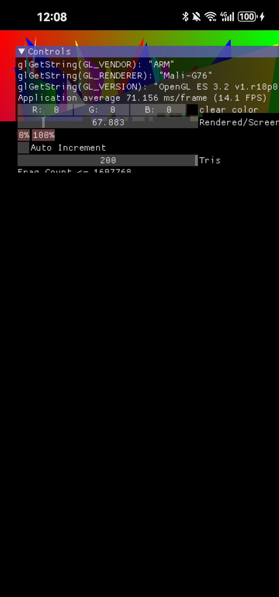
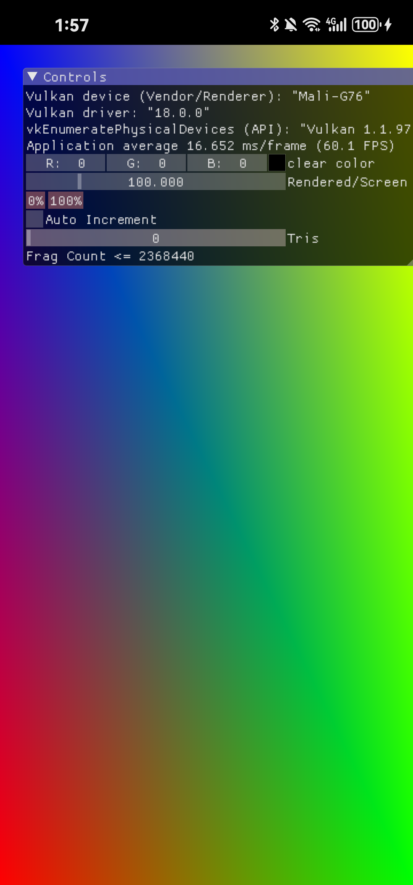

# TriangleBin-MultiPlatform

English | [中文](README.md)

A multi-platform port collection of [TriangleBin](https://github.com/Swung0x48/TriangleBin) for testing GPU fill rate and shading order:

- **Windows DirectX** — Direct3D 11 / 12, x86 / x64 / ARM64, Windows 7 and newer
- **Windows Vulkan** — Vulkan 1.0, x86 / x64 / ARM64, Windows 7 and newer (requires Vulkan support from your graphics driver)
- **macOS Metal** — Universal build for Intel (macOS 10.15+) and Apple Silicon (macOS 11.0+)
- **Android OpenGL ES** — OpenGL ES 3.2 with automatic fallback to 3.1, one APK with four ABIs, Android 5.0 and newer
- **Android Vulkan** — Vulkan 1.0, one APK with four ABIs, Android 7.0 and newer

It draws a stack of overlapping triangles and counts how many fragments the GPU actually rasterizes. That number tells you whether your GPU is **IMR** (immediate-mode rendering: every covered pixel of every triangle gets shaded) or **TBR** (tile-based rendering: geometry is binned per tile and each pixel is shaded roughly once).

## Download

Latest release: [**v1.1.0**](https://github.com/ddYIbb/TriangleBin-MultiPlatform/releases/tag/v1.1.0)

| Platform | Release file | Architecture |
|---|---|---|
| Windows DirectX | [TriangleBin-Windows-DirectX-v1.1.0.exe](https://github.com/ddYIbb/TriangleBin-MultiPlatform/releases/download/v1.1.0/TriangleBin-Windows-DirectX-v1.1.0.exe) | x86 / x64 / ARM64 |
| Windows Vulkan | [TriangleBin-Windows-Vulkan-v1.1.0.exe](https://github.com/ddYIbb/TriangleBin-MultiPlatform/releases/download/v1.1.0/TriangleBin-Windows-Vulkan-v1.1.0.exe) | x86 / x64 / ARM64 |
| macOS Metal | [TriangleBin-macOS-Metal-v1.1.0.zip](https://github.com/ddYIbb/TriangleBin-MultiPlatform/releases/download/v1.1.0/TriangleBin-macOS-Metal-v1.1.0.zip) | Universal (Intel / Apple Silicon) |
| Android OpenGL ES | [TriangleBin-Android-OpenGLES-v1.1.0.apk](https://github.com/ddYIbb/TriangleBin-MultiPlatform/releases/download/v1.1.0/TriangleBin-Android-OpenGLES-v1.1.0.apk) | arm64-v8a / armeabi-v7a / x86 / x86_64 |
| Android Vulkan | [TriangleBin-Android-Vulkan-v1.1.0.apk](https://github.com/ddYIbb/TriangleBin-MultiPlatform/releases/download/v1.1.0/TriangleBin-Android-Vulkan-v1.1.0.apk) | arm64-v8a / armeabi-v7a / x86 / x86_64 |

> **Not sure which one to download?** On Windows, pick the **DirectX build** — it has the best compatibility and automatically chooses between D3D12 and D3D11. Use the **Vulkan build** when you need a Vulkan comparison. SHA-256 checksums for all downloads are listed in the [release notes](https://github.com/ddYIbb/TriangleBin-MultiPlatform/releases/tag/v1.1.0).

Both Windows builds are **single-file launchers**: one <code>.exe</code> contains x86, x64 and ARM64 executables, picks the right one for your CPU at launch, and cleans up on exit. No installer, no registry writes.

The macOS build extracts to <code>TriangleBin.app</code>, a universal binary for Intel and Apple Silicon. If Gatekeeper blocks the first launch, right-click the app and choose "Open".

## Platform Requirements

| Build | OS | Graphics API | Notes |
|---|---|---|---|
| Windows DirectX | Windows 7 and newer | Direct3D 12 / 11 (automatic) | Shaders are embedded; no <code>d3dcompiler_47.dll</code> or VC++ runtime required |
| Windows Vulkan | Windows 7 and newer | Vulkan 1.0 core + <code>VK_KHR_swapchain</code> | Requires a Vulkan loader from your graphics driver |
| macOS Metal | macOS 10.15+ (Intel) / 11.0+ (Apple Silicon) | Metal | Universal binary |
| Android OpenGL ES | Android 5.0+ (API 21) | OpenGL ES 3.2 / 3.1 (automatic) | One APK with arm64-v8a / armeabi-v7a / x86 / x86_64; requires ES 3.1 support |
| Android Vulkan | Android 7.0+ (API 24) | Vulkan 1.0+ | One APK with arm64-v8a / armeabi-v7a / x86 / x86_64 |

## Features

**Automatic API selection.** The Windows DirectX build creates a Direct3D 12 device first and falls back to Direct3D 11 if that fails, with an explanation in the log.

**GPU selection (F2).** Both the Windows DirectX and Windows Vulkan builds let you choose the graphics adapter at runtime. The DirectX build lists every hardware DXGI adapter with its driver version and marks adapters without D3D12 support as <code>(D3D11 only)</code>; the Vulkan build lists Vulkan physical devices with driver and Vulkan versions. This is useful on laptops with both integrated and discrete GPUs — the adapter Windows picks by default is not necessarily the one you want to test. <code>Auto (best GPU for this app)</code> keeps the default behavior. Switching adapters requires recreating the device; the UI debounces rapid clicks over 300 ms into a single switch and waits for the previous frame to finish before releasing the old device, which prevents occasional hangs. When the same physical GPU is enumerated more than once by the driver or a virtual display adapter, the list merges those entries by PCI identity (VendorId / DeviceId / SubSysId / Revision) and driver version, keeping only one.

**Startup diagnostics.** If initialization fails fatally (for example, no device supporting DirectX 11 is found) or an unhandled exception occurs, the program writes <code>trianglebin-error-report.txt</code> next to the executable. It includes the OS version and build, CPU architecture, GPU name, driver version, the highest supported DirectX feature level, and the error itself. That file is usually all you need to debug a startup crash.

**Runtime value annotations.** Values that the original printed via <code>glGetString(...)</code> are now annotated with the DirectX call they come from: <code>DXGI GetDesc</code> (adapter), <code>DXGI CheckInterfaceSupport</code> (driver version), and <code>D3D12CreateDevice</code> / <code>D3D11CreateDevice</code> (active device). The Vulkan build likewise shows device, driver and Vulkan version.

**ARM64 support.** The x86, x64 and ARM64 configurations share the same source. ARM64 links SDL2 statically (<code>deps/SDL2/lib/arm64/SDL2-static.lib</code>) because MSVC cannot link the SDL2 dynamic library there; <code>src/sdl2_atomic_shim.c</code> supplies the missing <code>_Interlocked*</code> symbols.

**Single-file launcher.** <code>tools/launcher</code> embeds the x64, x86 and ARM64 executables as resources in one binary and extracts the one matching the current CPU at runtime. Releases therefore ship a single <code>.exe</code> per Windows build instead of one package per architecture.

**Performance and memory.** The DirectX and Vulkan backends prefer a <code>D16_UNORM</code> depth buffer (still precise enough for 0–200 triangle layers, at half the depth-buffer memory). D3D11 caches one RTV per back buffer and updates per-frame data via a dynamic constant buffer and a GPU-side UAV clear. D3D12 clears the fragment counter with <code>ClearUnorderedAccessViewUint</code>, removing two resource barriers and a 4-byte copy per frame. D3D11, D3D12, Vulkan and Metal all skip re-uploading the random triangle vertex buffer when the triangle count is unchanged.

## Relationship to the Original

This is a multi-platform port collection, not a patch. The core idea, controls and measurement method come from [TriangleBin](https://github.com/Swung0x48/TriangleBin) by Swung 0x48 (MIT). The Windows DirectX source lives in this repository; the Windows Vulkan and macOS Metal builds are distributed as release artifacts.

| | [TriangleBin](https://github.com/Swung0x48/TriangleBin) | TriangleBin-MultiPlatform (this repo) |
|---|---|---|
| Graphics API | OpenGL / OpenGL ES | Windows DirectX 11/12, Windows Vulkan 1.0, macOS Metal, Android OpenGL ES 3.1, Android Vulkan 1.0 |
| Platforms | Android (APK, split per ABI) + Windows x64 | Windows: x86 / x64 / ARM64; macOS: Intel / Apple Silicon; Android: one APK with four ABIs |
| Build | Gradle + Android NDK | CMake + MSVC (Windows DirectX source); Vulkan / macOS as release artifacts |
| GPU selection | None | Runtime GPU selection in Windows DirectX / Vulkan builds (F2) |
| Startup diagnostics | None | Error report on Windows startup failure; the Android builds log the reason and exit cleanly instead of crashing |

## Android Builds vs. the Original

Both Android builds are source-level rebuilds of the upstream Android app (upstream ships OpenGL ES only and requires ES 3.2). **The UI, controls, shaders and Frag Count math are identical**; only the items below differ:

| Item | Original TriangleBin (Android) | Android builds in this repo |
|---|---|---|
| Graphics context | Creates an OpenGL ES 3.2 context directly and crashes on devices that only support 3.1 | Tries ES 3.2 first, logs <code>Could not create OpenGL ES 3.2 context, retrying 3.1</code> and rebuilds on ES 3.1; if both fail it prints <code>Could not create required OpenGL ES 3.1 context.</code> and exits cleanly |
| Minimum graphics capability | OpenGL ES 3.2 | OpenGL ES 3.1 (the shaders use <code>atomicCounterIncrement</code> and a std140 UniformBlock, so ES 3.0 cannot work — 3.1 is the hard floor) |
| <code>ppf</code> display | Format string <code>"%.1f%%"</code>; Android bionic's <code>vsnprintf</code> collapses <code>%%</code> into a single <code>%</code>, garbling the number | Format string is <code>"%.1f"</code>, so it reads <code>1.0</code> like the desktop builds |
| App name / package | Triangle Bin / <code>com.socpk.trianglebin</code>; GLES and Vulkan builds replace each other | Triangle Bin (GLES) / <code>com.socpk.trianglebin.opengles</code> and Triangle Bin (VK) / <code>com.trianglebin.vulkan</code>; both can be installed side by side |
| APK split | One APK per ABI | One APK containing arm64-v8a / armeabi-v7a / x86 / x86_64 |
| Per-frame cost | 3 × <code>glGetString</code> and 1 × <code>glGetIntegerv(GL_VIEWPORT)</code> per frame, repeated <code>glBufferData</code> reallocations and uniform lookups, plus up to 15 × <code>glGetError</code> even in release builds | All cached at startup, buffers allocated once, uploads only when the triangle count changes, and <code>glCheckError</code> compiles to nothing under NDEBUG |
| Vulkan backend | None (upstream is OpenGL ES only) | New Vulkan 1.0 backend with the same Controls layout as the GLES build; recreates the swapchain after backgrounding |
| Version | — | Aligned with the other three platforms at v1.1.0 (versionCode 2) |

Measured on a local Android 12 x86_64 emulator (10-second <code>/proc/&lt;pid&gt;/stat</code> sampling): the GLES build's main-loop CPU went from 24.6% to 21.7% and the APK from 5,369,064 to 5,353,951 bytes; the Vulkan build went from 11.5% to 11.3% (its frame cost was already about 1.8 ms). Both are vsync-capped at 60 FPS, so frame rates do not reveal the difference — the savings show up in CPU time and GL/Vulkan call counts.

The Android sources live in a separate Gradle + NDK project; the binaries are distributed through Releases.

| Android OpenGL ES (PCT-AL10 / Kirin 980, 100% + 200 tris) | Android Vulkan (PCT-AL10 / Mali-G76, 100% + 0 tris) |
|---|---|
|  |  |

## UI Reference

| Control | Meaning |
|---|---|
| <code>Rendered/Screen %</code> | Rendered fragments divided by screen pixels, as a percentage from 0 to 500. |
| <code>0%</code> / <code>100%</code> | Jump directly to 0% or 100%. |
| <code>Tris</code> | Number of random triangles, 0–200, excluding the two full-screen triangles. |
| <code>Auto Increment</code> | Increment <code>Rendered/Screen %</code> automatically every frame. |
| <code>ppf</code> | Per-frame increment: how much <code>Rendered/Screen %</code> rises each frame when Auto Increment is enabled, 0–10. |
| <code>Frag Count</code> | Fragments actually rasterized by the GPU this frame; should not exceed the target. |
| <code>clear color</code> | Background color. |
| <code>F2</code> | Toggle the Select GPU window (Windows only; the Android builds show the active device and driver/API version at the top of Controls instead). |

Reading the results: raise <code>Tris</code> and watch <code>Frag Count</code>. If it keeps rising with the triangle count, every covered pixel of every triangle is being shaded — that is IMR behavior. If it stays clearly below the target and levels off, geometry is being binned and each pixel is shaded once per tile — that is TBR behavior.

## FAQ

**"Unknown publisher" or SmartScreen warning on Windows?**
Click "More info → Run anyway". The executables are not code-signed.

**Why don't I need <code>d3dcompiler_47.dll</code> or the VC++ runtime?**
The Windows builds compile their shaders at build time and use a static CRT.

**The Vulkan build says no Vulkan device was found.**
Install or update your graphics driver so it provides the Vulkan loader. Virtual machines, Remote Desktop sessions and some older drivers may not offer Vulkan support.

**macOS refuses to open <code>TriangleBin.app</code>.**
Right-click the app and choose "Open", or allow it under System Settings → Privacy & Security.

**Which Android build should I download?**
Pick the **OpenGL ES build** for compatibility (Android 5.0+, nearly every device); use the **Vulkan build** when you need a Vulkan comparison (Android 7.0+, requires Vulkan 1.0). The packages differ, so both can be installed.

**Why does the Android build need OpenGL ES 3.1?**
The shaders count fragments with <code>atomicCounterIncrement</code> and pass parameters through a std140 UniformBlock, and both require ES 3.1. ES 3.0 devices print <code>Could not create required OpenGL ES 3.1 context.</code> and exit — that is expected.

**The Android build shows a black screen at startup.**
<code>Rendered/Screen %</code> defaults to 0%, so the screen is black (same as upstream). Tap <code>100%</code> to reveal the gradient; drag <code>Tris</code> to 0 for the full-screen gradient.

**How do I tell whether D3D12 or D3D11 is active?**
The top of the Controls window shows <code>D3D12CreateDevice (API): "Direct3D 12"</code> or the corresponding Direct3D 11 information.

## Building

Requirements:

- Windows 10 or 11
- Visual Studio 2022 or newer with the **Desktop development with C++** workload
- CMake 3.20 or newer (the copy bundled with Visual Studio works)

SDL2, Dear ImGui and GLM are vendored under <code>deps/</code>; no package manager is needed.

~~~bash
git clone https://github.com/ddYIbb/TriangleBin-MultiPlatform.git
cd TriangleBin-MultiPlatform

cmake -S . -B build-x64 -A x64
cmake --build build-x64 --config Release
~~~

If CMake picks the wrong Visual Studio instance, specify the generator explicitly:
<code>-G "Visual Studio 17 2022"</code> or <code>-G "Visual Studio 18 2026"</code>.

The output is <code>build-x64/demo-dx.exe</code>. Copy <code>deps/SDL2/lib/x64/SDL2.dll</code> next to it before running.

For the other architectures, change the generator platform and output directory:

~~~bash
cmake -S . -B build-x86 -A Win32
cmake --build build-x86 --config Release

cmake -S . -B build-arm64 -A ARM64
cmake --build build-arm64 --config Release
~~~

ARM64 links SDL2 statically and does not need <code>SDL2.dll</code>.

### Single-file launcher

<code>tools/launcher</code> embeds the three executables and the two <code>SDL2.dll</code> files as resources. Configure it only after all three architectures have been built, because the resource compiler reads those files at build time:

~~~bash
cmake -S tools/launcher -B tools/launcher/build -A Win32
cmake --build tools/launcher/build --config Release
~~~

The output is <code>tools/launcher/build/demo-dx.exe</code>, a single distributable file. It is deliberately built as Win32 (x86) so that the same file runs on every Windows machine: x86 and x64 execute natively, and ARM64 goes through the built-in emulation layer.

<code>launcher.rc.in</code> is a template. At configure time <code>CMakeLists.txt</code> fills in the absolute paths of the payloads and generates <code>launcher.rc</code> in the build directory, so no machine-specific path is stored in the repository.

## Repository Layout

~~~text
src/                 DirectX 11/12 renderers, main program and SDL2 compatibility shim
tools/launcher/      Single-file launcher (embeds x86 / x64 / ARM64 payloads)
deps/                SDL2, Dear ImGui, GLM
docs/                README screenshots (Windows / Android)
CMakeLists.txt       Top-level build configuration
~~~

## Third-Party Components

| Component | Version | License |
|---|---|---|
| [SDL2](https://github.com/libsdl-org/SDL) | 2.30.11 | zlib |
| [Dear ImGui](https://github.com/ocornut/imgui) | — | MIT |
| [GLM](https://github.com/g-truc/glm) | — | MIT |

## License

MIT. See [LICENSE](LICENSE).

This project is based on [TriangleBin](https://github.com/Swung0x48/TriangleBin) by Swung 0x48 (MIT). The original copyright notice is preserved in <code>LICENSE</code>.

---

Questions or suggestions? Open an [issue](https://github.com/ddYIbb/TriangleBin-MultiPlatform/issues).
